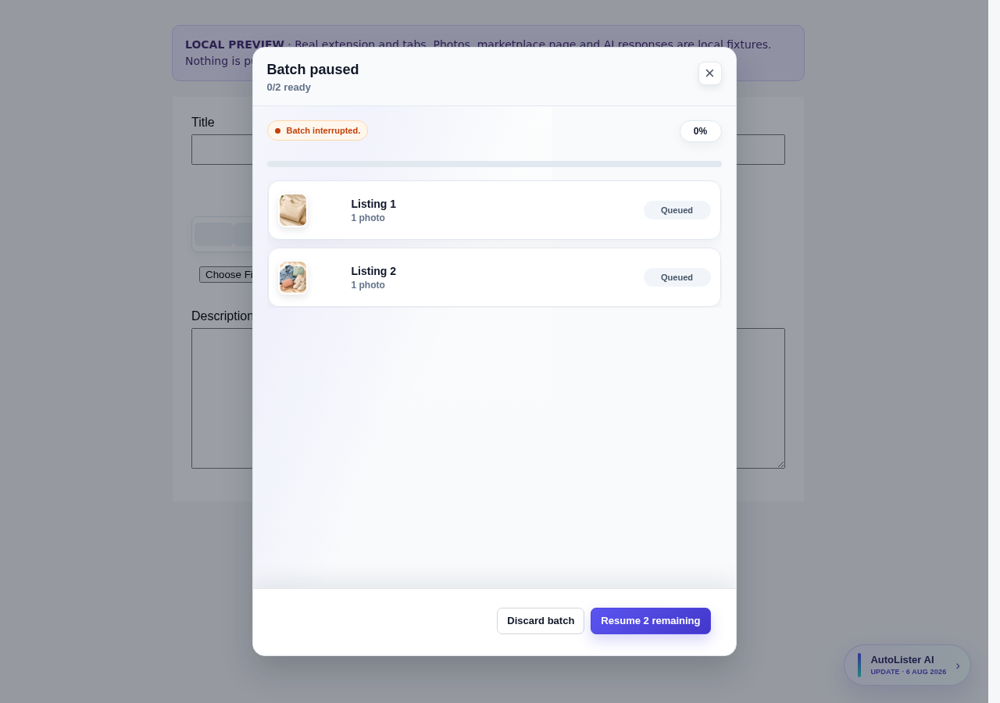
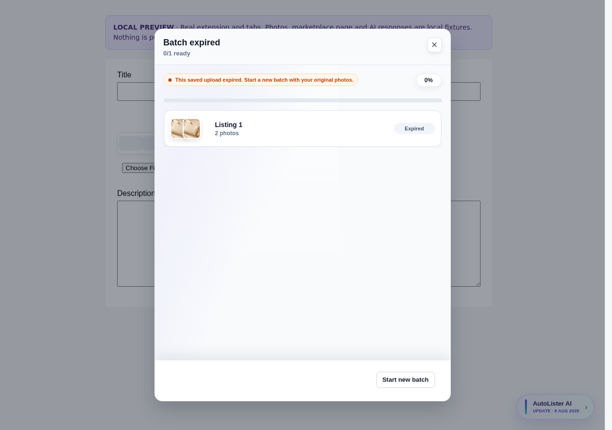
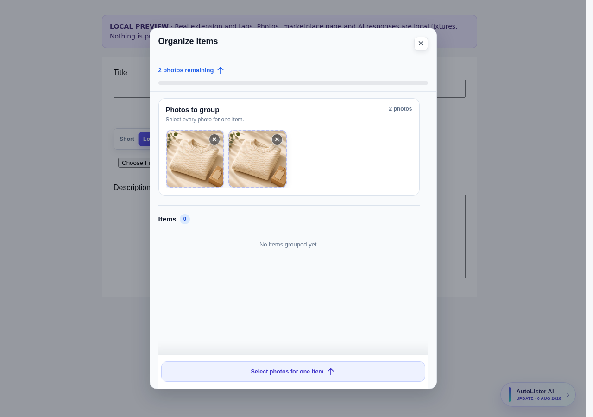
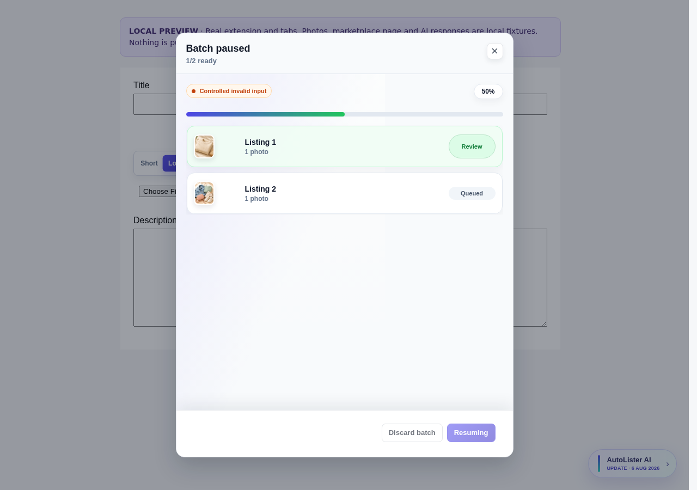
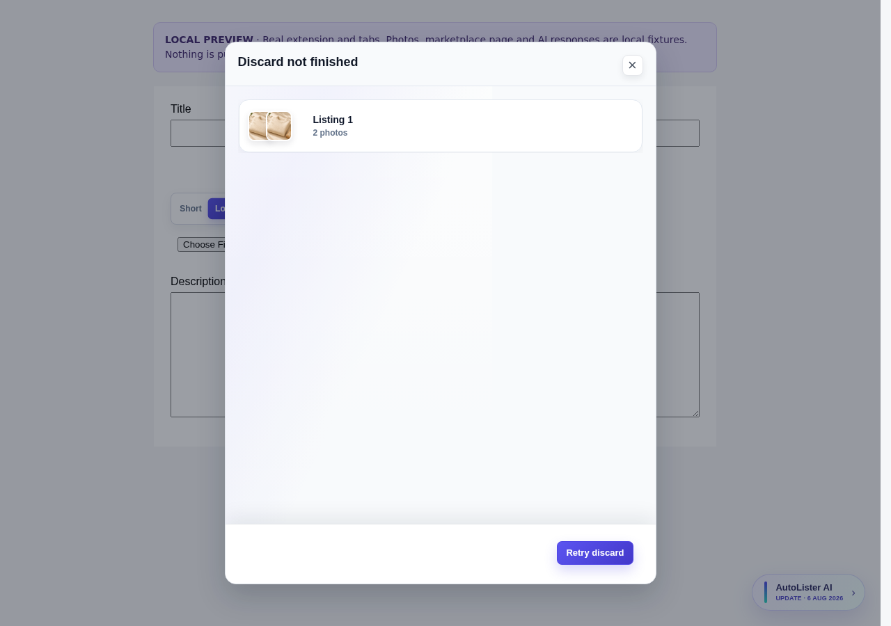
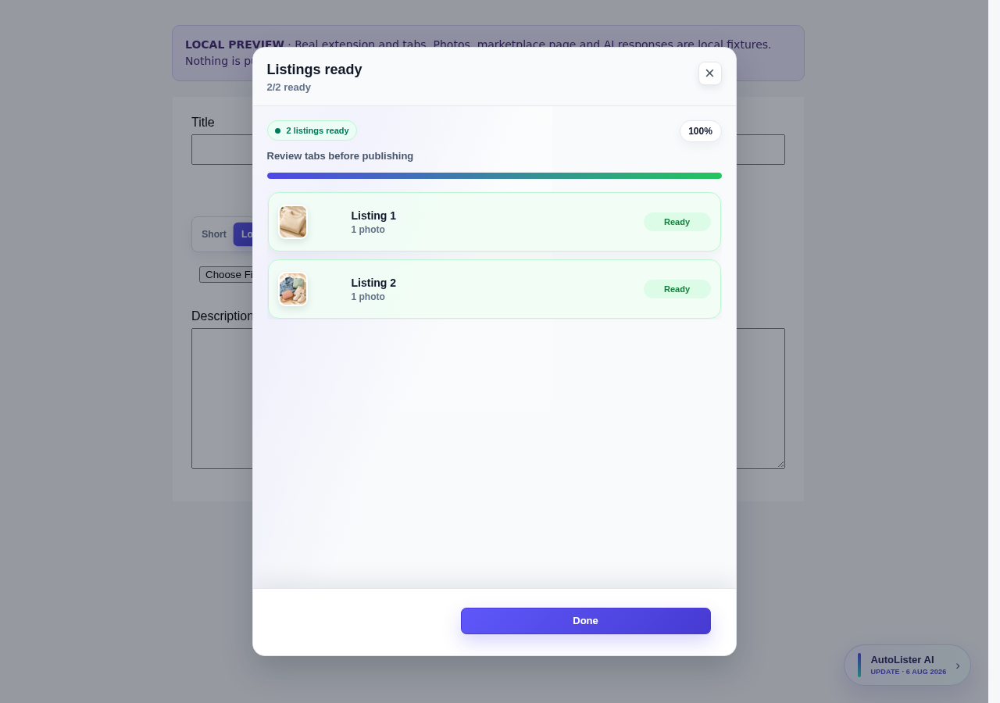
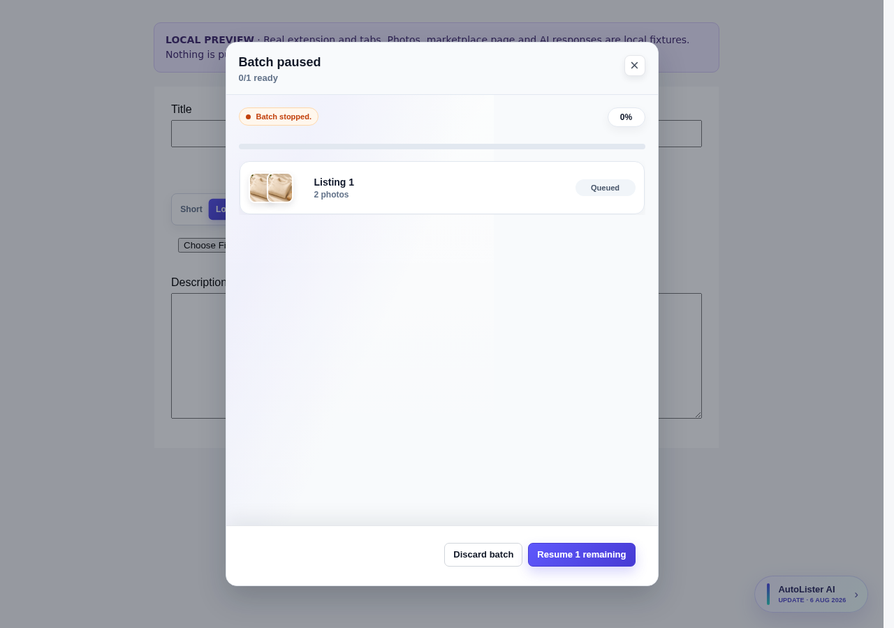
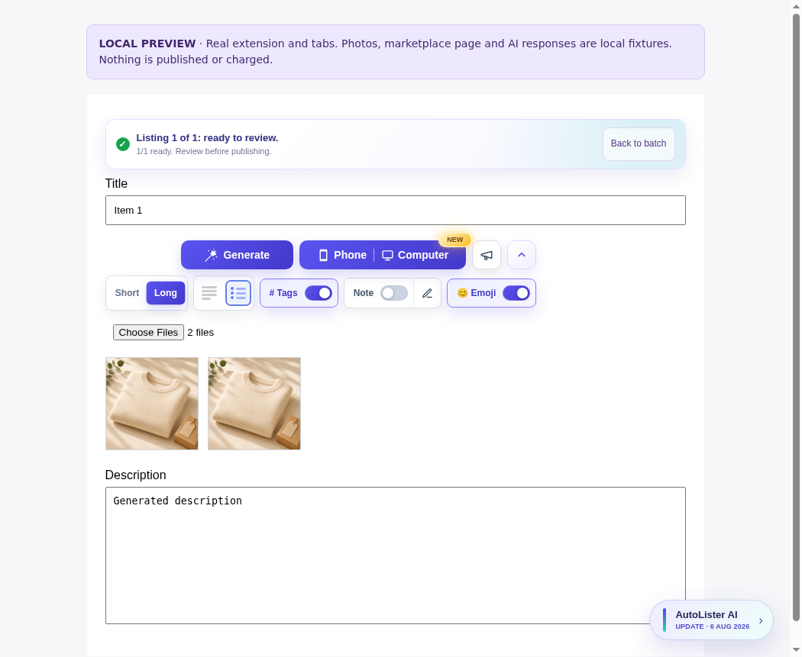

# AutoLister flow review

Current local candidate, captured 16-17 October 2026 (Amsterdam time). **Nothing here is production delivery proof.**

The primary agent operated and inspected the extension batch, single computer, single phone and separate web app flows. AI, auth and marketplace services were isolated. The phone transport section is from the real HTTP fault-test run and was visually inspected separately. No paid generation or live marketplace actions were used.

## Choose a flow

- [Extension batch](#extension-batch)
- [Single computer item](#single-computer-item)
- [Single phone item](#single-phone-item)
- [Exceptional recovery](#exceptional-recovery)
- [Web app batch](#web-app-batch)
- [Web app single item](#web-app-single-item)
- [Phone transport](#phone-transport)
- [Verification and limits](acceptance.md)

The marketplace page is a create-form fixture with the selectors used by the extension, not the full live Vinted React application. Native Orion/iOS is untested. Some country flag images are unavailable because external hosts are blocked. The extension flows use the pictured sweater and outfit files.

The extension opens each new tab while preparing. It stops following automatically when the seller edits, pauses following or moves elsewhere. The separate web app stays in place and offers Review as soon as each draft is ready.

## Extension batch

### 1. Compact entry

Actual loaded extension; the existing compact entry remains.

### 2. Choose single or batch

Sellers choose single or multiple listings.

[Full viewport](batch-02.png)

### 3. Photos ready to group

Four actual local image files. No permanent scrollbar in this viewport.

[Full viewport](batch-03.png)

### 4. Group an item

Select the photos belonging to one item.

[Full viewport](batch-04.png)

### 5. Ready for one Start

Two grouped items; the seller explicitly starts generation once.

[Full viewport](batch-05.png)

### 6. First tab opens while preparing

Active immediately, before controlled generation completes. Fields temporarily locked to protect edits.

### 7. Second tab opens while preparing

No extra Next or Start click; the second tab is active before its response completes.

### 8. Review while the next item prepares

First result is editable; one existing banner contains navigation. Editing pauses auto-follow.

### 9. Batch finished and ready to review

Second result keeps both photos and generated fields. Exactly two logical model results and one final cleanup.

### 10. Batch overview keeps review links

Each prepared listing remains accessible; no duplicate navigation banner.

[Full viewport](batch-10.png)

## Single computer item

### 11. Single computer photo ready

One actual file selected and retained. The standard Generate control remains.

### 12. Single item generating

Same page and photo remain; the request is held by the local model fixture.

### 13. Single result is editable

Photo retained, generated title and description visible, Generate reusable.

## Single phone item

### 14. Single phone photos received

Actual browser downloads and file attachment; the phone session metadata is controlled locally.

### 15. Phone photos generating on the same listing

Both photos remain on the listing while generation runs.

### 16. Single phone result ready

Both retained photos and editable output remain. Generate is usable again.

## Exceptional recovery

### 17. Connection wait

Automatic retry, retained photos and honest Waiting display. No forced Resume click. Refreshed by the primary on 17 October after the final copy reduction.

### 18. Explicit Stop preserves photos

Seller Stop pauses the batch and preserves the exact saved request and photos. Refreshed by the primary on 17 October after the final copy reduction.

### 19. Recovery after losing every original tab

Primary-operated Chromium. The real MV3 worker was terminated and both original create tabs were closed. A fresh same-account create page restored the existing batch without starting generation. The brief recovery screen offers explicit Resume or Discard.

### 20. Resume and Back use the restored controller

Primary clicked Resume, confirmed the exact prepared body was replayed, two logical items completed with one retained photo each, and clicked Back to batch from the actual foreground listing. It activated this restored controller. External model, auth and storage were controlled fixtures.

### 21. Explicit recovery finishes once

New work tab replays the saved request. One exact request ID, one identical payload and one modeled result. Refreshed by the primary on 17 October after the final copy reduction.

### 22. Server result still finishing

Controlled server commit-pending response shows Waiting and Finishing generation, with the exact ready count. Automatic replay continues. Refreshed by the primary on 17 October after the final copy reduction.

### 23. Photo download waits automatically

Actual extension and clothing files. Controlled source-photo fetch aborts keep the batch waiting, with no generation request while downloads are unavailable.

### 24. The new tab keeps a calm waiting state

One existing status banner. This controlled interruption requires no Resume click.

### 25. Photo download recovers after a worker restart

Primary-operated Chromium with controlled fetch aborts and actual worker termination. The client heartbeat message wakes the worker. Fetches resume automatically: two photos, one injection, one modeled generation and one cleanup.

### 26. Completion survives a temporary checkpoint failure

Primary-operated actual MV3 batch. One controlled final storage write failed, then the existing checkpoint retry completed safely. One modeled generation, two retained listing photos and one cleanup. Reload showed no false Resume prompt. No paid generation or live marketplace action.

### 27. Expired upload remains reachable after its controller closes

Primary-operated actual Chromium tabs. After one Return action, a controlled HTTP410 expired the original session. Closing the controller restored the existing Return button with expiry guidance. Clicking it recreated this screen without refreshing the listing tab.

### 28. Start a fresh upload without losing the listing tab

Primary clicked Start new batch, then the batch upload choice. The old checkpoint was cleared; two fixture photos appeared in the fresh upload and both earlier listing photos remained. No generation was started by these actions. New fixture files are controlled, not proof of a real phone transfer.

### 29. Recovery controls act once across tabs

One controller after Return from both retained listing tabs. During explicit Resume, conflicting actions are disabled. The earlier listing photos remain.

### 30. An unconfirmed discard offers only Retry discard

Cleanup HTTP 500 was controlled. Reload offers only Retry discard. Successful retry clears obsolete guidance and retains both listing photos. Remote storage retention after a production error is untested.

### 31. Completed listings do not wait for housekeeping

Both listings reached ready and Done worked while the cleanup response was held. A separate MV3 regression protects the next batch from late cleanup.

### 32. Stop takes priority over an older Resume

Primary-operated Chromium. A metadata response was held, then Stop was accepted from the bound work-tab protocol. Releasing that response started no generation. This specifically exercises stale-control handling.

### 33. Stop before the opened tab becomes ready

Primary clicked the visible Stop batch button while tab readiness messaging was held. Releasing readiness issued zero generation requests and no cleanup. Both source photos remained available.

### 34. Only explicit Resume continues the stopped batch

Primary clicked Resume afterward. One logical request produced the retained two-photo listing. Model, auth and host services were controlled fixtures.

## Web app batch

### 35. First-use style preferences

Existing compact preference setup; no batch redesign.

### 36. Web batch photos ready to group

Existing compact web grouping. Four actual local photos.

### 37. Web batch ready for Start

Two grouped drafts. Start stays explicit.

### 38. Batch starts in place

No automatic navigation on mobile.

### 39. First item ready before the batch finishes

Ready row offers Review instead of settings; second item continues.

### 40. Review and Copy while the batch continues

Compact progress remains; Copy works, unfinished Next is disabled.

### 41. Batch finishes without moving the seller

Text edits and focus remain; Next ready item is now available.

### 42. Explicit next ready item

Next opens Dress 2. Seller chooses when to move; Copy and Mark as listed remain accessible.

### 43. Both ready rows offer Review

Settings icons are replaced by Review on ready items.

### 44. Small phone review

At 320px the progress, Copy controls and Mark as listed fit without horizontal overflow.

### 45. Failed replacement identifies the previous text

Primary-operated browser with a controlled HTTP422. Existing Copy previous buttons preserve earlier work without another paid generation. Needs attention remains visible; the footer offers an optional explicit Retry with its cost.

### 46. The failure state at 320 pixels

Primary-operated viewport check. No horizontal overflow or extra recovery panel.

### 47. Explicit retry restores the normal review screen

Primary clicked Retry against the local model. Photos remained, the new text appeared, and ordinary Copy and Mark as listed returned.

### 48. Other failed items remain visible after retry and reload

Automated real-browser evidence, separately inspected. One item was retried successfully. The other still shows Needs attention after reload.

## Web app single item

### 49. Single web item with photos

Existing compact single-item workspace and Generate.

### 50. Single web item prepares in place

Photos stay visible and there is no batch navigation.

### 51. Single web result ready to Copy

Existing compact review screen, clipboard works, photos retained.

## Phone transport

### 52. Connection loss keeps the selected photos

Passed. Actual multipart upload over loopback HTTP with controlled socket loss. Automatic retry and explicit Cancel remain available.

### 53. Progressing slow upload completes

Passed. One actual upload took about 60 seconds without a retry. The noise image is deliberate high-entropy test data.

### 54. Expired session is terminal

Passed. Explicit HTTP 410 shows clear expiry guidance without revived Retry or Cancel controls.

### 55. Seller cancellation stops retrying

Passed. Actual browser Cancel stops retries and leaves the cancelled screen. The disabled photo control cannot restart this session.

## Observed limits for final review

The manual review caught a misleading 99% during connection waiting. The corrected screen shows Waiting and identifies the waiting item, while its exact ready count remains visible. The regression passed three rounds, including worker restart, and the primary repeated the pictured recovery walkthrough. Screenshots alone do not certify assistive-technology behavior, full keyboard access, arbitrary browser suspension recovery or live marketplace compatibility. Automated assertions and full gates are recorded in the acceptance evidence.
