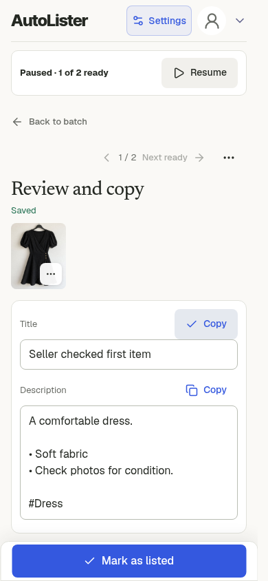

# Verification and limits

The final source and package passed root verification and a totally fresh independent review: **GO, no open confirmed findings**. Both minor copy findings were corrected and independently rechecked on the exact final commits. API `ea5966b` is deployed to production. Deployment 7136156767 succeeded in Production quick-vint-api, and the public app bundle plus all four shared helpers byte-match the final build. The extension production pipeline passed and pushed frontend `b1088b1`. The [Chrome Store upload-and-submit workflow](https://github.com/samicodesit/quick-vint-frontend/actions/runs/39012948783) is running its own checks. Upload and submission are not yet confirmed; Store version 1.4.16 remains live. See the [independent report](independent-review.md) for scope and limits.

## Intended experience

- Extension: one explicit Start. Each listing tab opens while preparing. Editing, pausing following or moving elsewhere prevents focus stealing. Ready listings remain editable and accessible through Review.
- Separate web app: stay on the current screen. Review, edit, copy and mark each ready item while later work continues. Navigation is explicit. The queue owns its order independently of browser Back/Forward.
- Single-item upload remains reusable. Original photos, cancellation, account isolation and uncertain request identity stay protected.
- Helper text is omitted unless it explains a necessary action, consequence or recovery. The paused web caption and duplicate extension completion summary were removed. Waiting and failure explanations remain.

## Current verification

| Scope | Evidence |
| --- | --- |
| API/site production gate | 994 tests passed, four existing opt-in skips. Lint, types, formatting and build passed on the final caption change. |
| Frontend full gate | 124 unit checks and 290 browser checks passed, two existing opt-in skips; production build passed. |
| Actual release ZIP | 35 payload files match the validation package. Its extracted, minified extension passed 48 browser checks over three rounds. |
| Recovery and ownership | 108 recovery checks over three rounds; 20 ownership unit tests. |
| Final repair matrix | 51 final browser checks over three rounds, including closed controllers, delayed or missing completion, another active batch, cleanup failure, cancellation, stale progress and tracking. |
| Completion, copy and geometry | 36 checks over three rounds across completion, navigation, layout and signed URLs. |
| Web history | Six journeys over three rounds, using reversed order and distinct second-batch items. Back, Forward, progress, reload, Resume, completion and Next were exercised. |
| Web replacements and failure | Nine normal/queued/failed journeys over three rounds, plus fresh, legacy, missing-context and mixed-result cases. Failed items remain Needs attention; Copy previous never generates. |
| Large web batch | 20 items completed once each. Early Review, editing, Copy, Next and Back worked while later items continued; no page errors. |
| Full web UI | Latest 24-check journey passed without page errors after caption removal. |
| Phone transport | 19 actual HTTP journeys, including file input, compression, multipart upload, socket loss/reconnect, Cancel, expiry, idle timeout and a progressing upload lasting about 60 seconds. |

Final independent follow-up passed on API `ea5966b`, frontend `b1088b1` and the unchanged tested 1.4.17 package.

## What was reproduced and repaired

Old same-owner progress could replace a newer batch's controls and stop its heartbeat. Progress now joins the durable owner, batch, source controller, item, generation attempt, Stop revision, status and discard flag before side effects. A late pause cannot revive Resume after discard intent is saved.

Closing progress before a later host-photo failure dropped the existing pause diagnostic. Terminal tracking now runs before the renderer's visibility guard, retaining the original error and matching attempt.

A delayed completion message outlived the one-second controller deadline, while cleanup removed its completion proof. Completion now has a small per-batch receipt, saved atomically in the existing bounded review map. Temporary-file and finished-request cleanup still proceed. A delayed message or later heartbeat can recover that batch's ready state after a new batch starts. Closing an older completed overview cannot discard the newer batch. A closed controller cannot block a fresh setup.

Browser history could save the old review order into a newer queue. The queue now persists its own run order. Explicitly opening one of its items restores that order. Fresh-entry navigation excludes unresolved failures and unfinished items.

The full gate also caught a direct UUID call bypassing the established fallback, plus an obsolete synthetic message without an owned checkpoint. The fallback was reused and the test's checkpoint/message were brought into protocol. All five affected checks passed three rounds. Product ownership checks were kept strict.

## Primary manual browser review

The primary agent operated the extension batch, computer/phone single item and separate web flows. This included real tab activation, editing, worker interruption, loss of original tabs, retained photos, recovery controls and clipboard use. Controlled protocol faults were labelled separately from ordinary UI clicks.

The latest extension walkthrough used four clothing photos, two groups and one Start. Both listings completed with two photos each and two generation requests. The refreshed overview keeps both Review links without a duplicate completion summary. The final manual completion check withheld the first batch's terminal message, started another batch, recovered Ready through native focus, and closed the old overview without touching the new batch. Both listings retained two clothing photos and there were two logical generation requests.

The latest phone-width web check opened the first ready item while the second was paused by a reload test. Editing, Copy and Mark as listed worked before the remaining item resumed. Copy triggered no generation. Explicit Resume completed the remaining item, both photos stayed present, and 320px/390px screenshots were inspected.

The screenshot below is that exceptional reload case. Normal generation continues while the seller reviews; it does not require pausing first.

## Evidence boundaries

Chromium ran the actual MV3 worker, tabs, messaging, storage and file inputs. The web app used actual IndexedDB, image preparation and clipboard. Phone fault tests used loopback HTTP and real controlled connection loss.

Auth, model, remote storage and the marketplace host were isolated fixtures. A forced host rejection or delayed response demonstrates the tested client boundary, not the historical cause of a customer's failure. Replay proves client request reuse, not production credit accounting.

The latest reused live DOM canary was from 15 October, extension 1.4.16, on the authenticated Vinted NL create page. It proved selectors and injection at that time, not the full candidate flow or live React behaviour.

Native Orion/iOS, arbitrary OS suspension, live marketplace generation/publication, production billing and exact historical customer recovery remain unverified. No paid generation or live listing action was used. Passing local checks does not establish a refund, historical recovery or a published listing.

## Final copy follow-up

The batch summary uses a compact failed count, while the item keeps its failure heading. The redundant previous-text sentence was removed because Copy previous already identifies retained output. The idle-expiry hint hides after expiry or cancellation. The primary repeated the failed-output flow at 320px and 390px, copied prior text without generation, reloaded and explicitly retried. The 24-check web journey and full 994-test API gate passed on these changes. Actual HTTP expiry and cancellation checks passed. No extension runtime or ZIP changed.

## Change size

Compared with the previous production commits, runtime product code changed by +1,905 / -398 lines across ten files. Tests, QA tools and documentation account for +5,711 / -344 lines, with 79 screenshot files in the production diff. Release configuration and agent rules account for +18 / -4 lines. The final screenshot walkthrough is maintained on this separate documentation branch.
