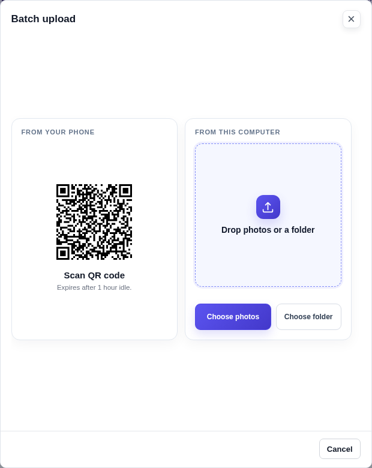
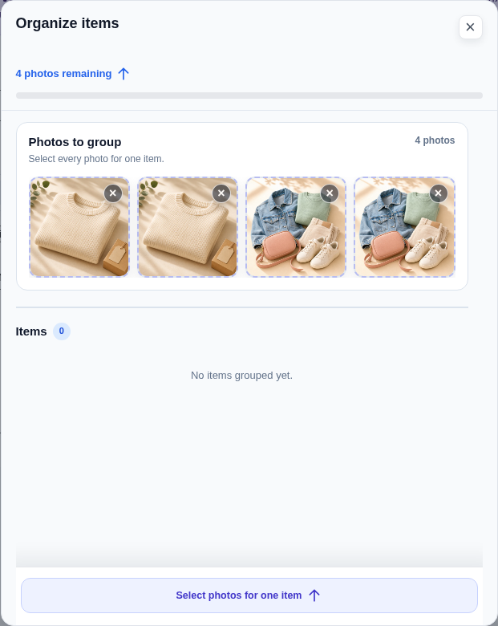
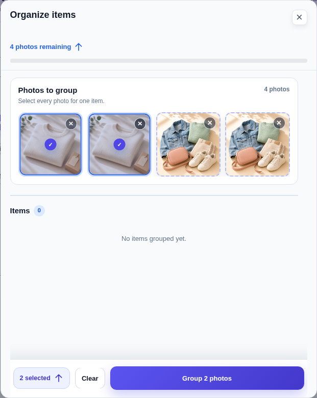
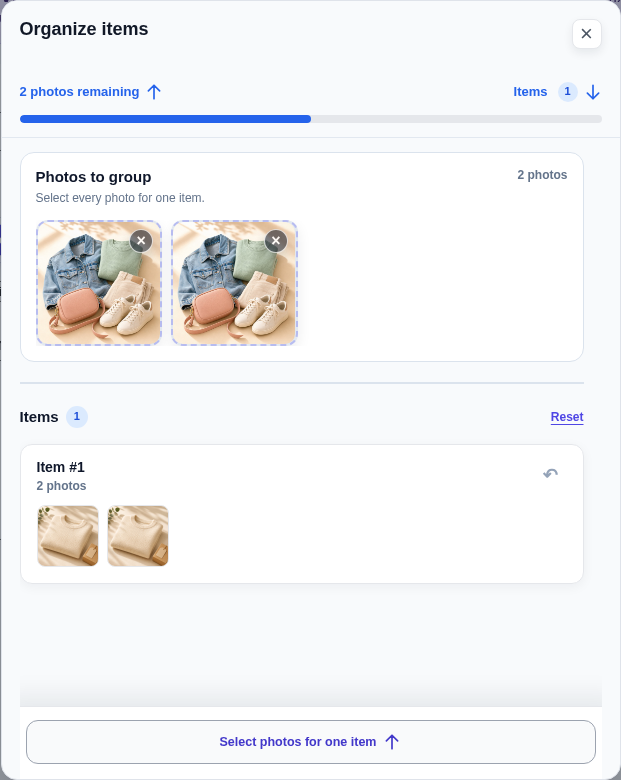
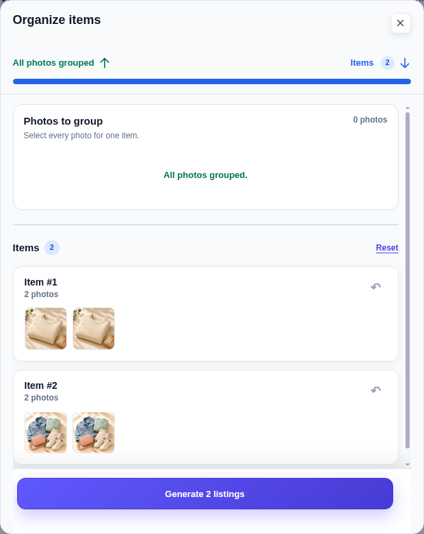
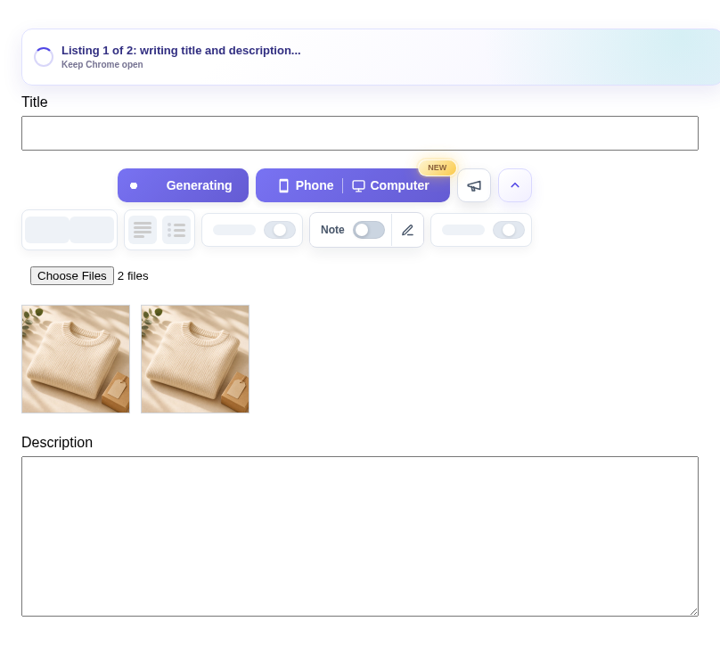
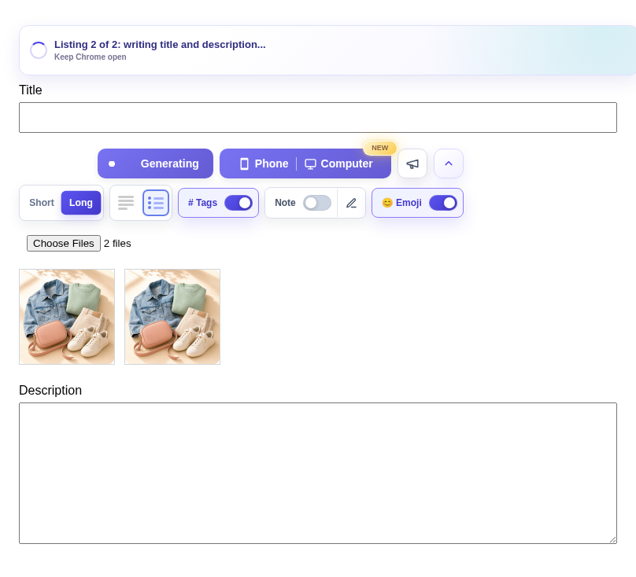
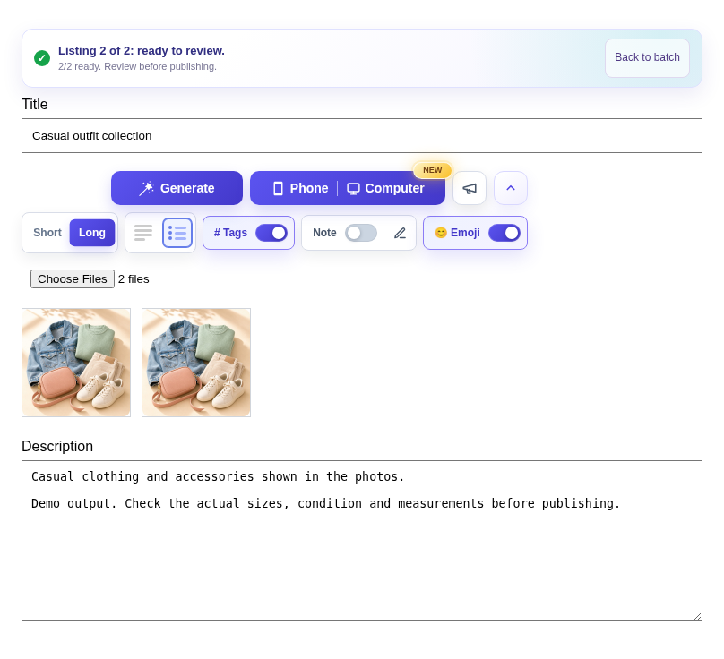
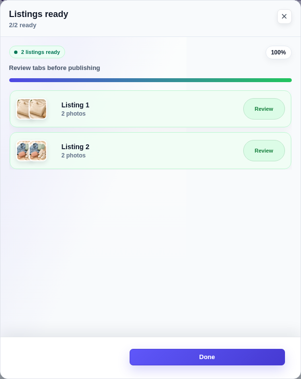
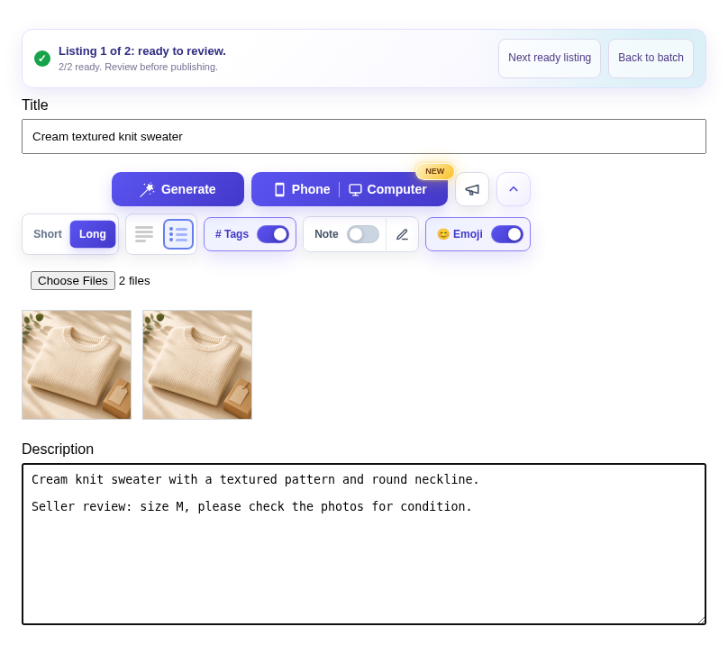

# Extension batch flow

[All flows](README.md) · [Evidence and limits](evidence.md)

**Unreleased interaction review.** Real MV3 extension and Chromium tabs. The marketplace form, storage, auth and AI services are controlled local fixtures.

## 1. Choose the photo source

Start with Phone or Computer on the existing toolbar.

[Full viewport](batch-01.png)

## 2. Choose the upload flow

Single item and multiple items stay in the existing chooser. Photos for this local demo are supplied by fixtures.

[Full viewport](batch-02.png)

## 3. Add batch photos from phone or computer

The existing upload step offers a QR code, file selection, folder selection and drag-and-drop. This capture precedes receiving photos.

[Full viewport](batch-02a.png)

## 4. Receive photos for a batch

Four pictured demo files have arrived. The organizer is the real extension UI.

[Full viewport](batch-03.png)

## 5. Select photos for the first item

Two selected sweater photos make one listing.

[Full viewport](batch-04.png)

## 6. First item grouped

The first group stays visible and the two remaining photos can form the second item.

[Full viewport](batch-05.png)

## 7. Both items grouped

All four photos belong to two listings. Generation has not started.

[Full viewport](batch-06.png)

## 8. First listing opens immediately

Actual Chromium focus moved before the controlled AI response was released. The title is still empty and preparation is visible.

[Full viewport](batch-07.png)

## 9. First listing ready

Photos and generated text are present, fields are editable, and one status banner contains navigation controls.

[Full viewport](batch-08.png)

## 10. Second listing opens while preparing

No extra Next or Start click. The second actual tab becomes active before its controlled generation completes.

[Full viewport](batch-09.png)

## 11. Both listings ready

The second tab stays active. Two controlled generation requests completed, one per item, with no extra Continue click.

[Full viewport](batch-10.png)

## 12. Batch summary with review links

Two listings are ready. Review links reopen the existing listing tabs.

[Full viewport](batch-11.png)

## 13. Review and edit the prepared listing

The original listing tab reopens. A real input edit persists while both listings remain ready. Nothing is published.

[Full viewport](batch-12.png)
