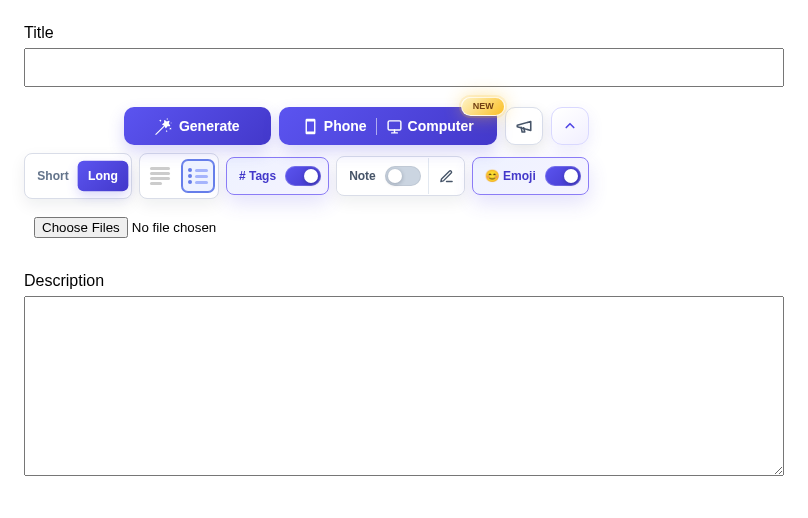
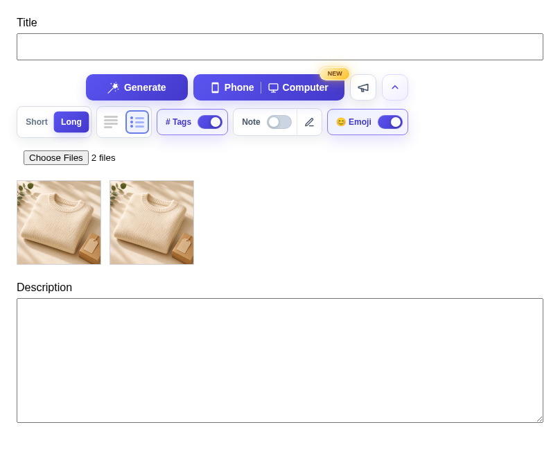
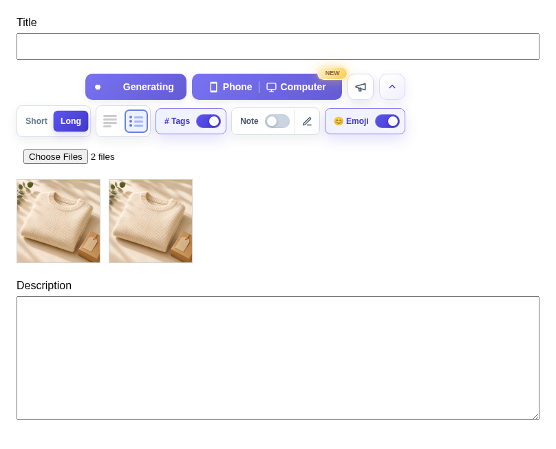
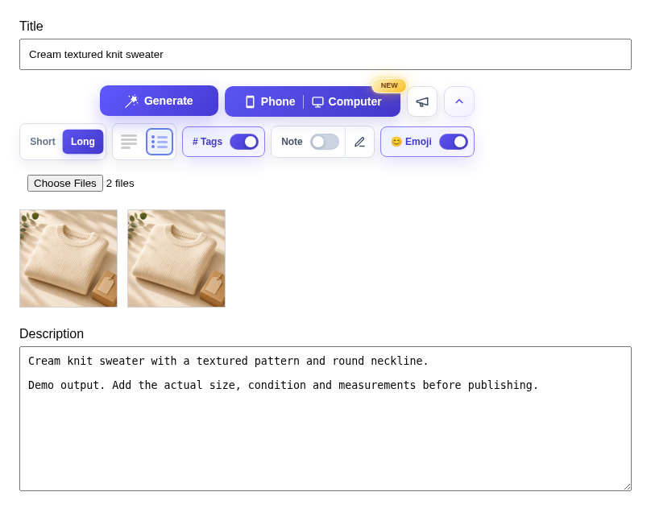
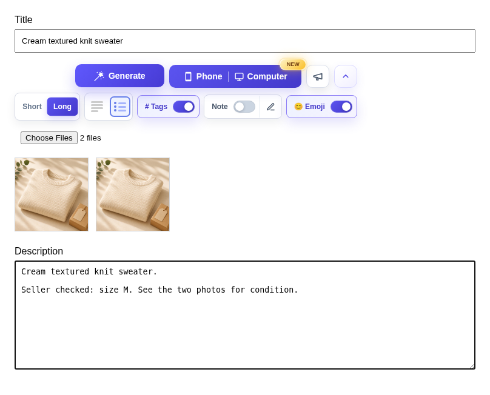

# Extension single item, computer photos

[All flows](README.md) · [Evidence and limits](evidence.md)

**Unreleased interaction review.** Actual browser file selection and extension behavior, with controlled storage, auth, host photo acknowledgement and AI.

## 1. Single item from computer

Start with the existing AutoLister toolbar. The surrounding listing page is a simplified local fixture.

[Full viewport](single-computer-01.png)

## 2. Two photos selected

Actual browser file selection and real multipart requests were used. Temporary storage and the host photo acknowledgement are controlled.

[Full viewport](single-computer-02.png)

## 3. Generation in progress

The real extension submitted one request. The response is held locally so the pending state can be reviewed.

[Full viewport](single-computer-03.png)

## 4. Generated title and description

Title and description are filled. Generate returns to its usable state after the normal brief success indication.

[Full viewport](single-computer-04.png)

## 5. Review and edit

A seller can edit the generated description. No batch controls are added. Nothing is published.

[Full viewport](single-computer-05.png)
