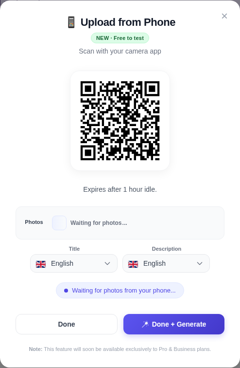
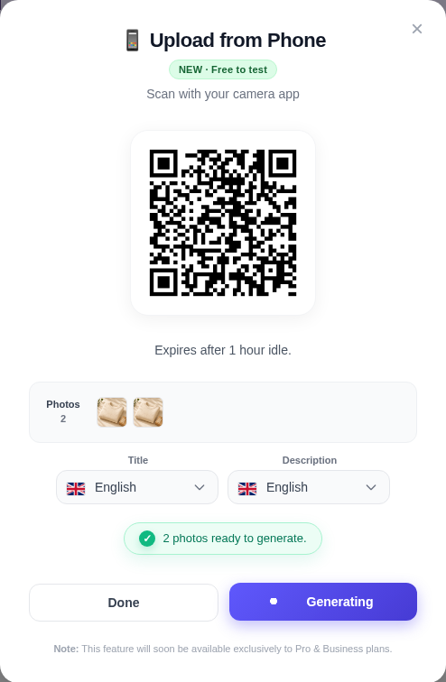
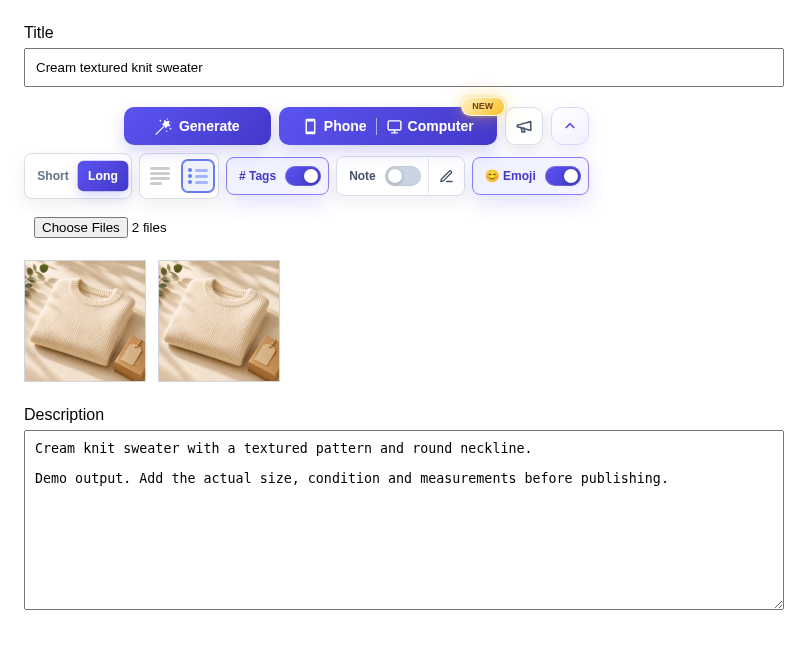

# Extension single item, phone handoff

[All flows](README.md) · [Evidence and limits](evidence.md)

**Unreleased interaction review.** Actual extension UI. Phone session readiness is controlled. No actual handset upload or network recovery is certified.

## 1. Single-item phone handoff

Scan the QR code to add photos. This shows the real extension UI; transport is controlled for this walkthrough.

[Full viewport](single-phone-01.png)

## 2. Photos received from the controlled phone session

Two photos are ready. This is not proof of an actual handset upload or transport recovery.

[Full viewport](single-phone-02.png)

## 3. Generate from the phone modal

The extension injects the photos and sends one generation request. The controlled response is held.

[Full viewport](single-phone-03.png)

## 4. Single item prepared

The phone modal closes, the two photos remain, and text is filled into the existing fields.

[Full viewport](single-phone-04.png)
