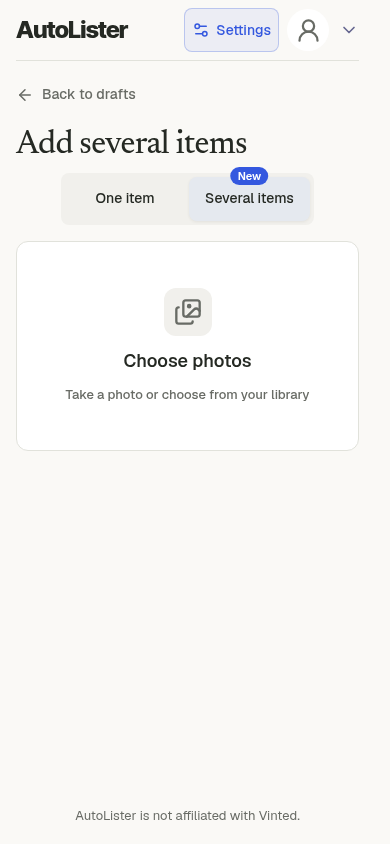
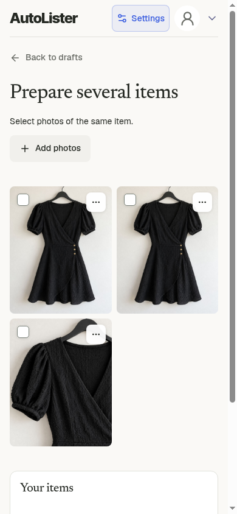
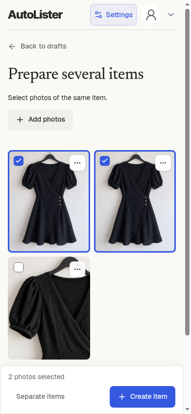
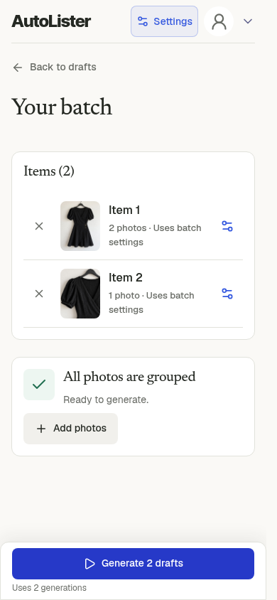
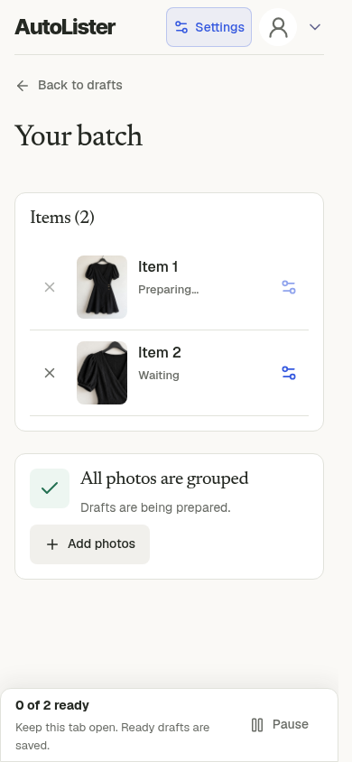
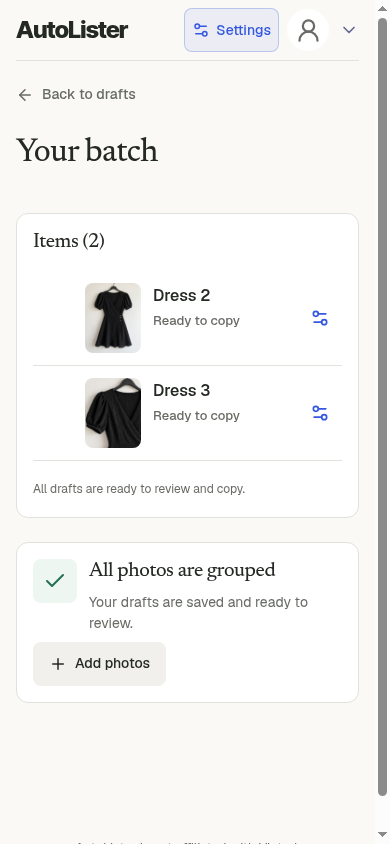
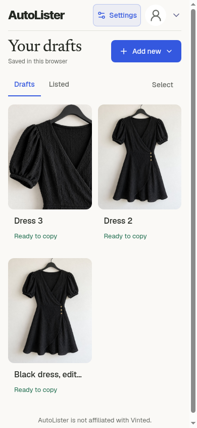
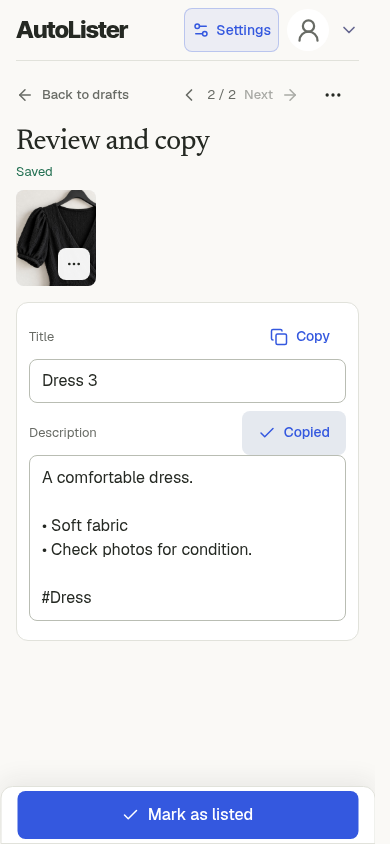
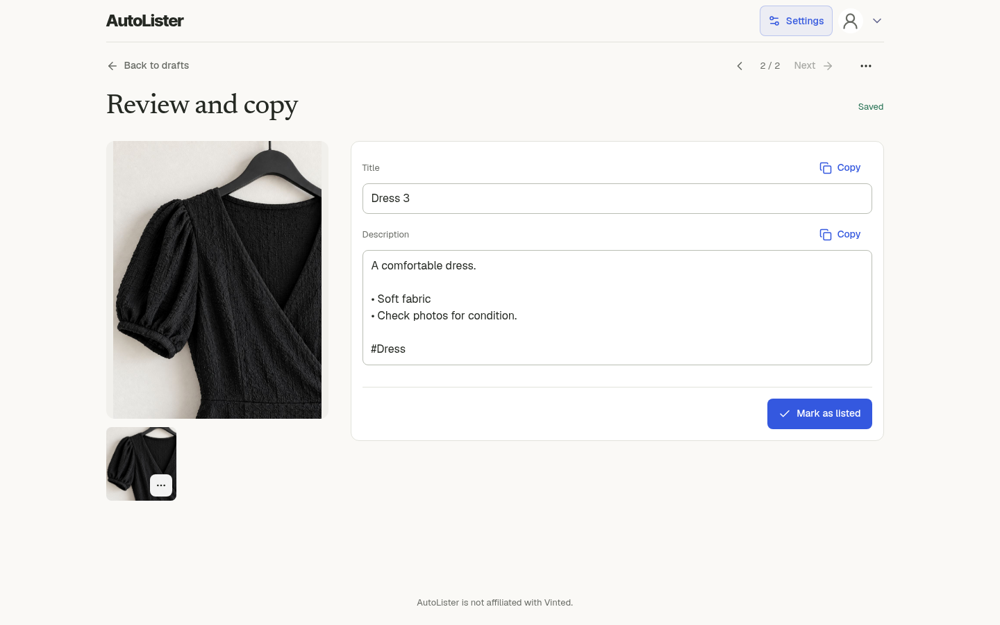

# Web app batch

[All flows](README.md) · [Evidence and limits](evidence.md)

**Unreleased interaction review.** Actual compact local web app at 390 px, plus a desktop view. Auth and backend generation/storage are controlled.

## 1. Add several items

The existing compact batch entry screen. No new web app navigation or layout was introduced.

[Full viewport](web-batch-01.png)

## 2. Three photos ready to group

Real image preparation and browser storage. Select the photos belonging to each item.

[Full viewport](web-batch-02.png)

## 3. Select photos of one item

Two selected photos are grouped into one item through Create item. The third photo becomes a separate item.

[Full viewport](web-batch-03.png)

## 4. Two grouped items ready

All three photos are assigned to two items. The seller explicitly starts generation once for the batch.

[Full viewport](web-batch-04.png)

## 5. Batch generation in progress

The first grouped item is generating. The controlled model response is held; no paid generation is called.

[Full viewport](web-batch-05.png)

## 6. Both items ready to copy

The existing sequential queue finished both items without another Start or Continue click.

[Full viewport](web-batch-06.png)

## 7. All prepared drafts in the library

The earlier single item and both new batch items remain saved locally.

[Full viewport](web-batch-07.png)

## 8. Open and copy a batch draft

Each prepared draft opens in the same compact editor. The actual browser clipboard contains this draft description.

[Full viewport](web-batch-08.png)

## 9. Desktop layout remains compact

The existing web app at 1440 px after image loading and layout paint. Cover and thumbnail reference the same selected-item blob. No product UI files were changed.

[Full viewport](web-batch-09.png)
