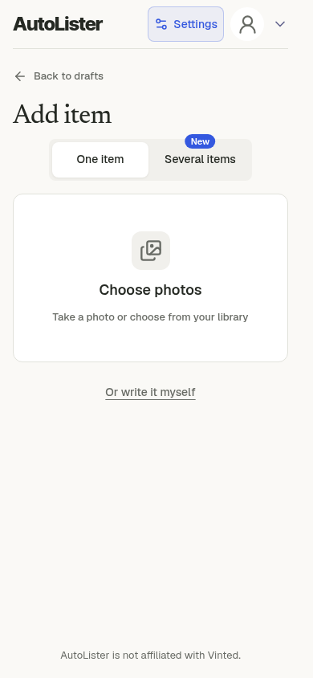
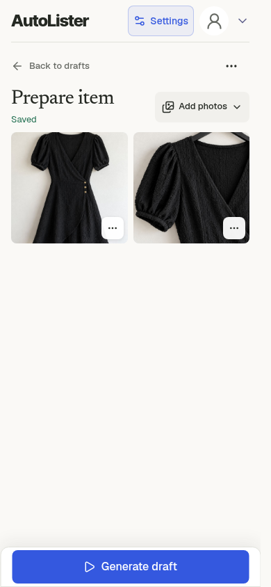
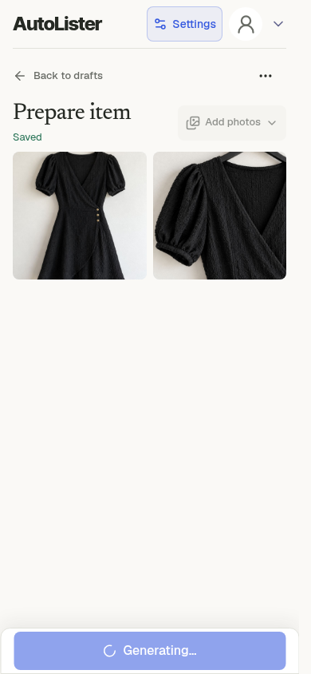
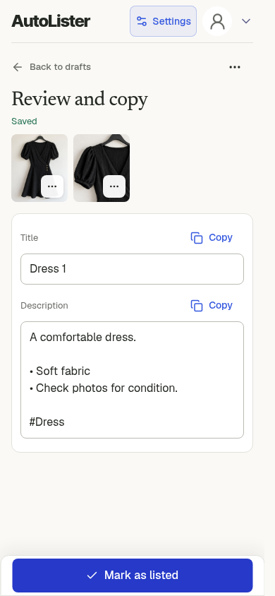
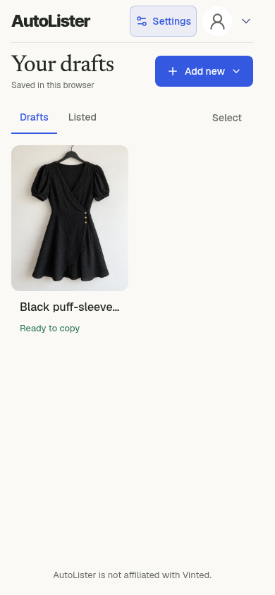
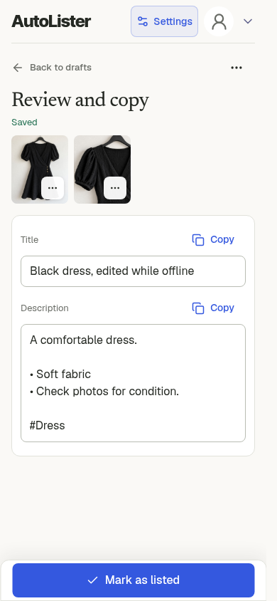

# Web app single item

[All flows](README.md) · [Evidence and limits](evidence.md)

**Unreleased interaction review.** Actual compact local web app at 390 px, with browser image preparation, storage and clipboard. Auth and backend generation/storage are controlled.

## 1. First-use listing style

Current compact web app at 390 px. A newly created fixture account sees the existing first-use style screen.

[Full viewport](web-single-01.png)

## 2. First item opens after style setup

Use this style opens a new item directly, so the seller can add photos immediately.

[Full viewport](web-single-02.png)

## 3. One item with two photos

Actual browser file selection, image preparation and browser storage. Generation remains an explicit action.

[Full viewport](web-single-03.png)

## 4. Generation in progress

Real web UI and upload requests, with storage and AI services controlled. The model response is held for inspection.

[Full viewport](web-single-04.png)

## 5. Generated item ready

Generated text is editable in the compact existing editor. These outputs come from the test fixture, not a paid model.

[Full viewport](web-single-05.png)

## 6. Review, edit and copy

A real edit is saved in browser storage. Copy title writes the reviewed title to the real browser clipboard.

[Full viewport](web-single-06.png)

## 7. Draft saved in this browser

The prepared item appears in the existing draft library. Browser-local storage is not cloud synchronization.

[Full viewport](web-single-07.png)

## 8. Reload retains edits and both photos

After a real page reload, the same local draft, reviewed title and two photos reopen. No extra generation was requested.

[Full viewport](web-single-08.png)

## 9. Editing works offline

Chromium network is actually offline. The title edit saves locally. This does not test upload or generation recovery.

[Full viewport](web-single-09.png)
