# Web batch review: work as each item becomes ready

Local candidate, not deployed. This update changes the web app only. The extension source is unchanged.

Start the batch once. Review and copy the first ready item while later items prepare. Nothing opens automatically. One compact progress panel stays available during review. Next ready only opens an available result. Copy leaves the item as a draft; Mark as listed is an explicit seller confirmation.

**Current limit:** keep AutoLister open while preparing. This remains a browser-owned queue. This UI update does not make the remaining batch run while iOS suspends the browser. Durable server processing is a separate proposal, not an implemented feature.

These are actual screenshots from the production web build running locally, operated through browser controls. Images, local storage, editing and clipboard are real. Auth, uploads to temporary storage and AI responses are controlled fixtures. Chromium at phone dimensions is not native iPhone or Orion certification. No customer data, paid generation or live Vinted listing is involved.

Tap a screenshot to open it at full size. [Verification and limits](evidence.md). [Other flows](../2026-10-16-flows/README.md).

## 1. Choose photos

Select photos and group the ones belonging to the same item.

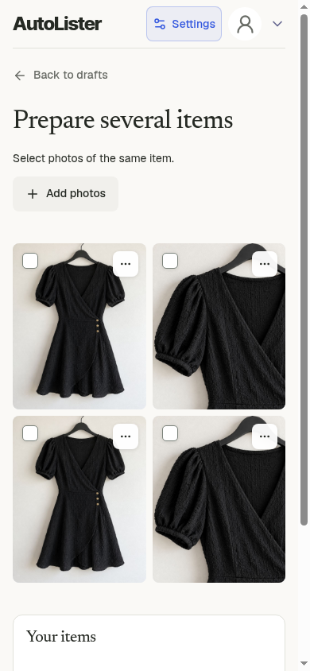

## 2. Start the batch once

Grouping and settings remain available before generation. Start explicitly with Generate 2 drafts.

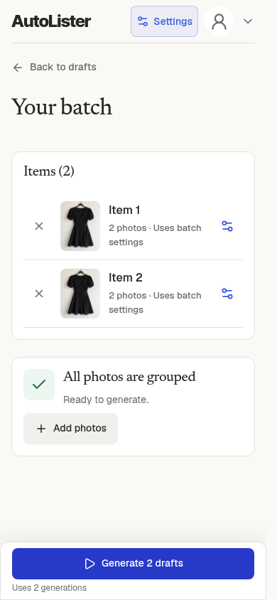

## 3. See preparation begin

The overview stays in place. There is one progress indicator. The old grouping-complete card disappears once preparation starts.

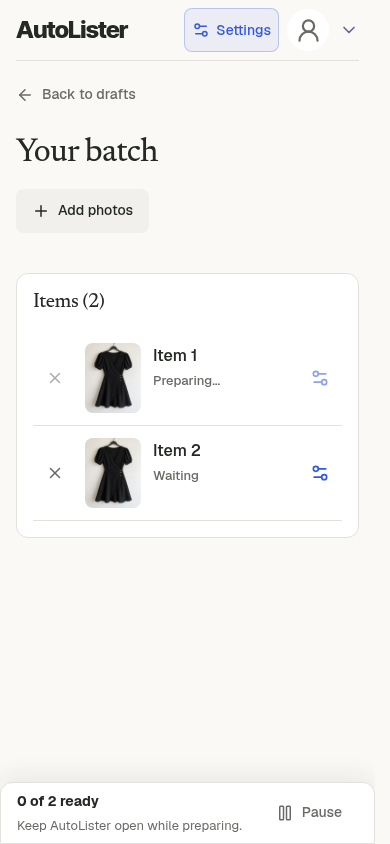

## 4. Review immediately

The first completed row offers Review instead of a settings icon. Item 2 is still preparing. There is no need to wait for the whole batch.

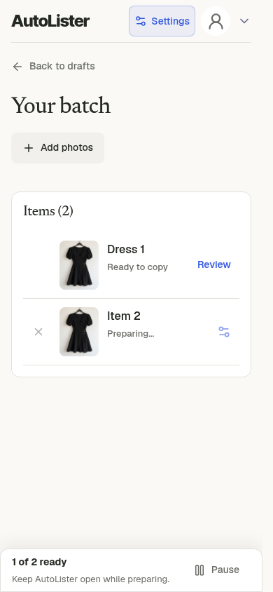

## 5. Keep track while reviewing

The existing compact editor has one small progress panel. Next ready is disabled while there is no later result. Back to batch remains available.

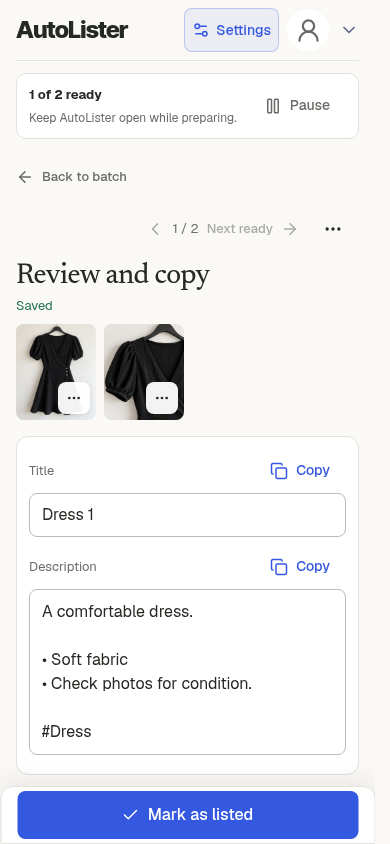

## 6. Edit and copy now

The seller can check the photos, edit the result and copy immediately. Clipboard content was checked. Copy does not mark the item as listed.

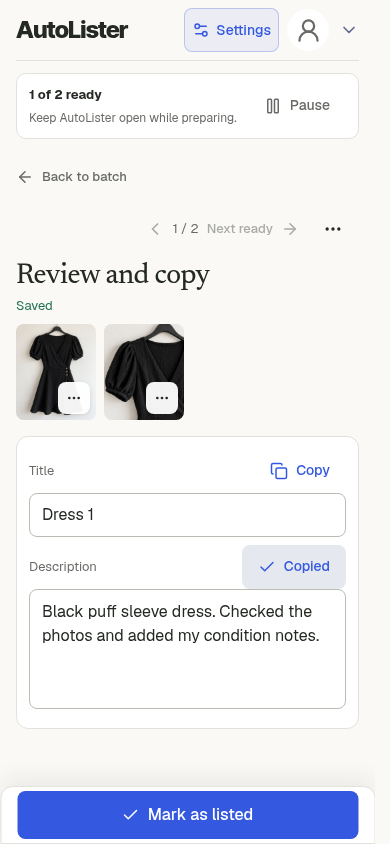

## 7. Later completion leaves the seller in place

The count becomes 2 of 2. The seller stays on the same item, with their edits intact. There is no forced jump or extra completion panel.

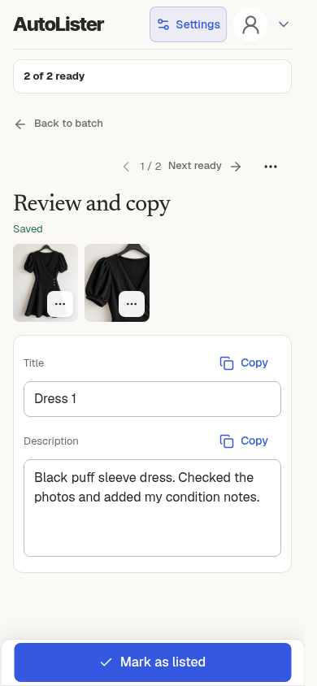

## 8. Choose the next ready result

Next ready now opens item 2. Generation finishing alone never opens it.

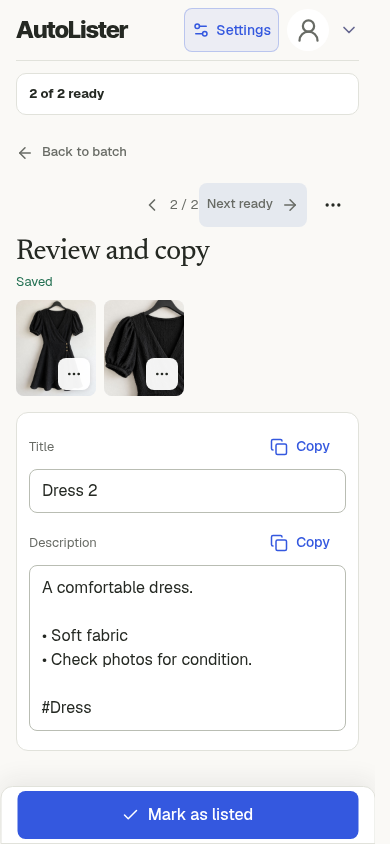

## 9. Return to the batch

Each completed row offers Review. The redundant All photos grouped card stays hidden.

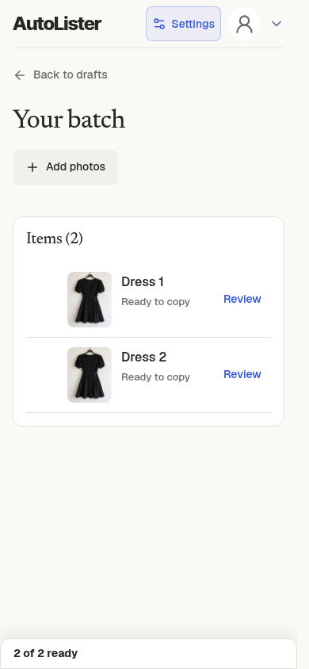

## 10. Mark as listed only when appropriate

In this local check the seller explicitly marked item 1 as listed. The existing flow advanced to item 2 and retained Back to batch. This changes local status only. No marketplace publication happened.

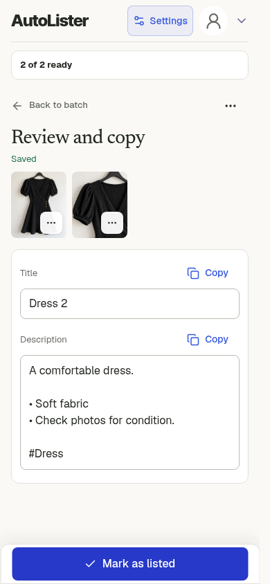

## 11. A new single item still works

Opening a new single item after a batch shows Generate draft, without stale batch progress.

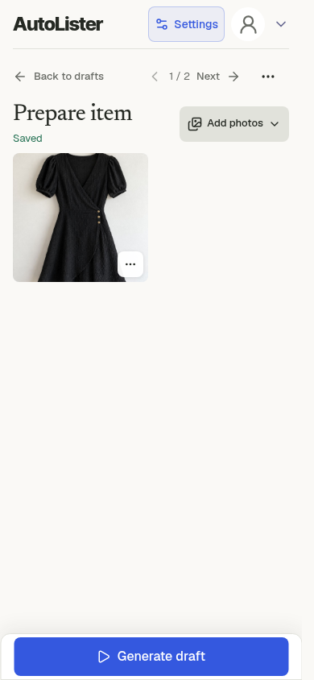

## 12. Small phone

At 320px the Settings control uses its existing icon and accessible label, so it fits beside the logo and account button. The usual 390px header remains unchanged.

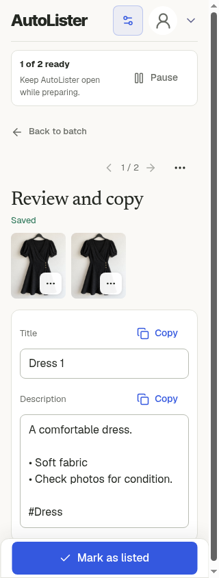

## 13. Tablet

The existing photo and text layout stays intact.

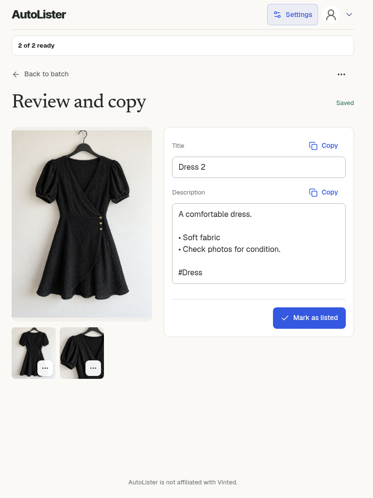

## 14. Desktop web app

One progress indicator, the existing editor and the same explicit seller actions.

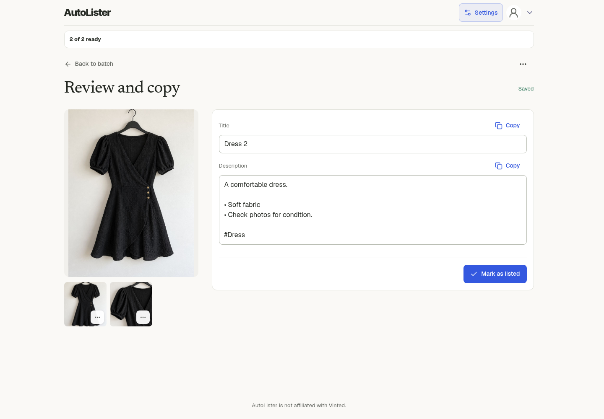

## 15. Progress stays visible while scrolling

This long-description stress check uses repeated fixture notes. The progress panel sits below the sticky header. It does not hide behind the header or cover the bottom action.

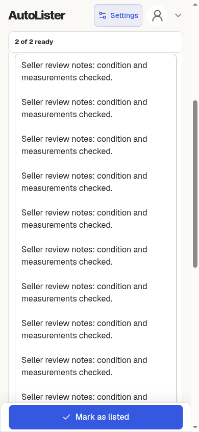
